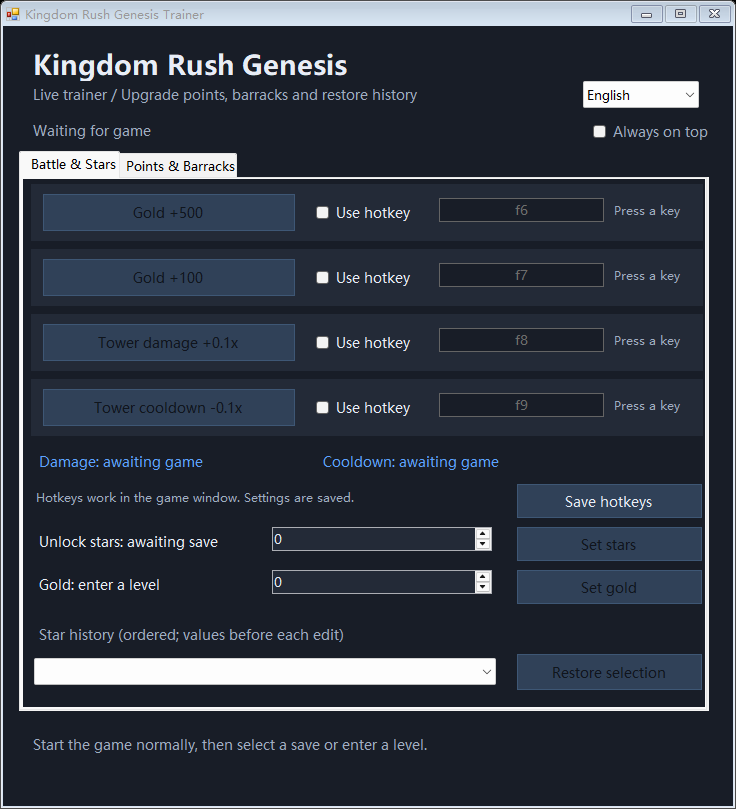
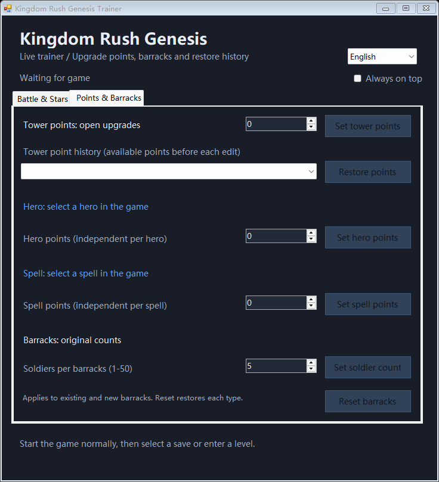

# Kingdom Rush Genesis Trainer

[中文说明](README.zh-CN.md) · [Download the Windows release](https://github.com/Hidessp/kingdom-rush-genesis-trainer/releases/latest)

A Windows trainer for **Kingdom Rush Genesis (王国保卫战 6)**, with switchable **English / 中文** UI. This project targets the LuaJIT/LÖVE Windows build with `Kingdom Rush Genesis.exe` and `lua51.dll`. It is not a trainer for other Kingdom Rush titles. Compatibility has been tested with the author's local build; other game versions may differ.

## Features

- Add 500 or 100 gold; edit the current level's gold directly.
- Increase tower damage by 0.1x, including tower-attributed soldiers, projectiles and skills.
- Reduce tower skill cooldown by 0.1x, up to nine steps (minimum 0.1x).
- Optional, customizable game-window hotkeys for the four incremental actions.
- Edit unlock stars, with ordered history of the values before each edit and a restore dropdown.
- Edit global tower upgrade points, with a separate ordered history and restore dropdown.
- Edit the selected hero's and selected spell's available upgrade points independently.
- Set soldiers per barracks (1–50), and reset each barracks type to its own original count.
- Language selection, always-on-top mode, current values and connection feedback.

## Install

1. Download and extract `KR6Trainer-v1.0.0-Windows.zip` **into your game directory**, beside `Kingdom Rush Genesis.exe`. Keep the `src` folder.
2. Close the game. Install **64-bit Python 3** if needed, then double-click `Install.cmd`. Python is required only for installation / uninstallation; running the trainer uses Windows .NET Framework 4.x.
3. Start the game using its normal launcher. Open `KR6Trainer.exe` (or `Start-English.cmd`). Wait for “Connected to game”.
4. Use the language dropdown at the top right to switch between English and 中文. Your choice is saved. The default follows Windows' UI language.

Command line alternative: `python install.py --game-dir "D:\Your Game Folder"`.

The installer patches your own executable locally and creates `.kr6-trainer-backup/Kingdom Rush Genesis.original.exe`. Preserve that backup. It verifies that existing archive entries other than the entry point retain their CRC and sizes, and that barracks-related modules are unchanged. Re-running the installer rebuilds from the original backup. Close the game before updating.

The repository and release contain the trainer and bridge source, **no game executable, game assets, native game libraries, personal saves, credentials or player history**. Obtain your own game copy separately.

## Use and persistence

Gold changes require an active level. Star editing requires a selected save; reopen the map / unlock screen to refresh the displayed stars.

For tower points, open the global upgrades screen in the game. For hero / spell points, open the desired unit's upgrade tree and verify its name in the trainer before applying. Points are independent per hero and per spell; edits do not change levels, XP or purchased upgrades. Spending points still reduces the balance, and natural gains still accrue.

Star and tower-point dropdowns show **previous values in edit order**, filtered by save slot. Restore sets the remaining balance and creates another history entry. It does not undo purchased upgrades or claimed rewards. These histories and first-edit save snapshots are stored locally in `trainer-data/`.

Damage, cooldown and barracks overrides last for the current game process, including level transitions. Restarting the game resets them to defaults. Stars, upgrade points, histories and hotkey preferences persist. Increasing the barracks count uses the game's normal summon flow; lowering it removes excess soldiers. Reset restores each type's original count rather than a common value.

Hotkeys work only inside the game window, are disabled by default, and cannot share the same key combination. Capture a key or Ctrl / Alt / Shift combination and click **Save hotkeys**.

## Uninstall

Close the game and run `Uninstall.cmd`, or `python install.py --uninstall --game-dir "D:\Your Game Folder"`. This restores the original game executable while preserving saves and `trainer-data/`. Uninstalling the bridge does not revert previously saved star / point edits; use the restore controls beforehand if desired.

## Build and verification

Run `powershell -ExecutionPolicy Bypass -File .\build.ps1` on Windows with .NET Framework 4.x. No NuGet dependencies. `src/Trainer.cs` contains the WinForms UI and translations; `src/bridge.lua` contains runtime hooks and file-based IPC.

`KR6Trainer.exe --en` / `--zh` selects a language for that launch. `--self-test` checks key naming and localization invariants. Installer round-trip tests are in `tests/test_install.py`; provide your local game library through `KR6_LUA51_DLL` to run them. No game files are included in the tests.

Before this release, 65 existing runtime assertions and 53 new point/barracks assertions passed against the local game's original APIs and templates. Actual game connection, barracks set/reset, invalid-context rejection and the original health-system damage calculation were also checked. Both English pages were rendered and inspected. This does not establish compatibility with all builds or every combat situation.

## License

Trainer code: [MIT](LICENSE). Kingdom Rush names and game content belong to their respective owners. This is an independent project, not an official release.
